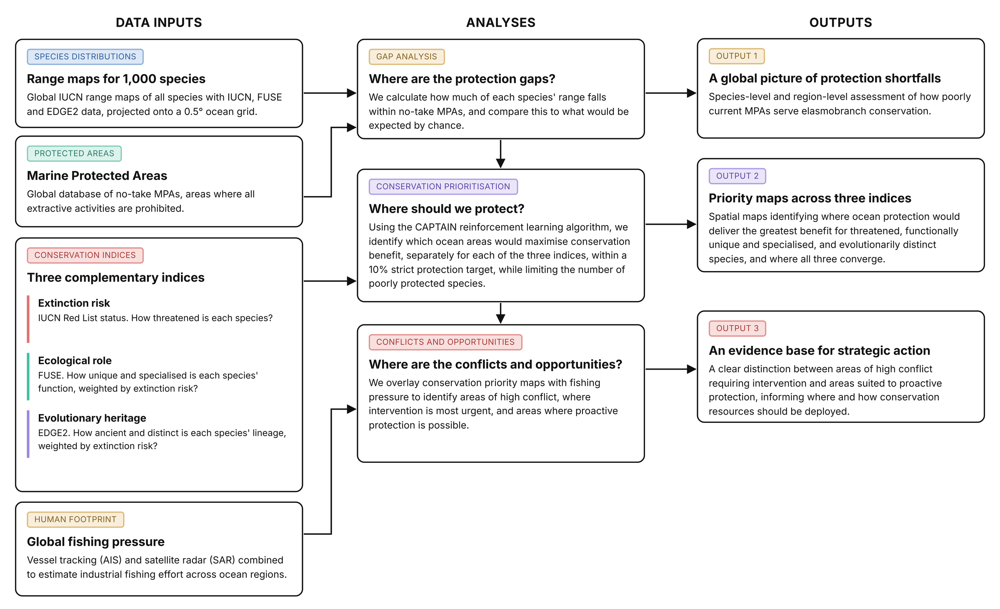

# Global gaps and priorities for shark and ray conservation

[](https://theophilemt92.github.io/shark-ray-conservation-priorities/)
[](https://doi.org/10.5281/zenodo.20719267)
[](https://www.biorxiv.org/content/10.1101/2025.11.28.691085v1)

Data and code for the manuscript:

> Mouton, T. L., Silvestro, D., Kocáková, K., Spitznagel, D., Leprieur, F., & Pimiento, C. Global gaps and priorities for shark and ray conservation: Integrating threat, function, and evolutionary distinctiveness. *Science Advances* (in revision). Preprint: [bioRxiv 10.1101/2025.11.28.691085](https://www.biorxiv.org/content/10.1101/2025.11.28.691085v1)



The study has three components:

1. **Gap analysis**: how much of the range of each of 1,000 elasmobranch species is covered by no-take marine protected areas (MPAs), compared with a null model of random MPA placement.
2. **Conservation prioritisation**: where a no-take network covering 10% of the ocean would best protect species according to their extinction risk (IUCN status), functional distinctiveness (FUSE) and evolutionary distinctiveness (EDGE2), optimised with the CAPTAIN reinforcement learning algorithm.
3. **Overlap with fishing effort**: where these priorities overlap with high or low industrial fishing effort, estimated from vessel tracking (AIS) and satellite radar (SAR) data.

---

## Read the analyses

> [!TIP]
> Every analysis is a reproducible Quarto report. The reports below open in any web browser and show the methods, results, figures and tables of the manuscript, with the code folded under each step. No programming knowledge is needed to read them.

| | Report | What it shows | Manuscript items |
|:-:|---|---|---|
| 1 | [**Data preparation: species table and conservation metrics**](https://theophilemt92.github.io/shark-ray-conservation-priorities/R/Code/01_data_preparation.html) | Builds the table of IUCN, FUSE and EDGE2 classes for the 1,000 species, and checks it against the IUCN Red List | Input to all analyses |
| 2 | [**Normalising SAR vessel detections by satellite overpasses**](https://theophilemt92.github.io/shark-ray-conservation-priorities/R/Code/02_SAR_overpass_normalisation.html) | Explores how satellite overpass frequency affects SAR vessel detections, and why detections are normalised by overpass | Supporting analysis |
| 3 | [**Global fishing effort from AIS and SAR data**](https://theophilemt92.github.io/shark-ray-conservation-priorities/R/Code/03_fishing_effort.html) | Combines AIS fishing hours and SAR detections, and predicts fishing hours where only SAR detections exist with a random forest model | Figs. S13 to S16, Tables S6 to S9 |
| 4 | [**Gap analysis: coverage of shark and ray ranges by no-take MPAs**](https://theophilemt92.github.io/shark-ray-conservation-priorities/R/Code/04_gap_analysis.html) | Species and regional coverage by no-take MPAs, comparison between IUCN categories, and null model of MPA placement | Fig. 2, Figs. S1 to S8, Tables S1 and S2 |
| 5 | [**Conservation priorities with CAPTAIN v3**](https://theophilemt92.github.io/shark-ray-conservation-priorities/R/Code/05_CAPTAIN_analyses_protpop_worst.html) (main analysis) | Priority maps, protection of species by class, congruence among dimensions, sensitivity to the protection target, and overlap with fishing effort | Figs. 3 to 5, Figs. S9 to S12, Tables S3 to S5 and S10 |
| 6 | [**Conservation priorities with CAPTAIN v3, class-weighted reward alone**](https://theophilemt92.github.io/shark-ray-conservation-priorities/R/Code/05_CAPTAIN_analyses_protpop.html) | Same report with the class-weighted reward alone, for comparison | Figs. S17 and S18 |

The same reports are in `R/Code/` (`.qmd` source and rendered `.html`). The conceptual diagram (Fig. 1) is drawn in `R/Code/Fig1_conceptual_diagram.html`.

---

## Repository structure

```
.
├── Manuscript repo.Rproj         RStudio project (paths are built with here::here())
├── R/
│   ├── Code/                     Quarto reports (.qmd) and rendered reports (.html)
│   ├── Data/                     Input data and summarised CAPTAIN outputs used by the reports
│   │   └── CAPTAIN3/             Summarised CAPTAIN v3 outputs
│   ├── Quarto_template/          Report styling (CSS, header, footer)
│   └── Outputs/                  Figures and tables produced by the reports
│       ├── CAPTAIN3_protpop_worst/   Main CAPTAIN results (class-weighted and worst-served reward)
│       └── CAPTAIN3_protpop/         CAPTAIN results with the class-weighted reward alone
└── Python/
    ├── captain3/                     CAPTAIN v3 scripts used for the runs (data preparation, training, predictions)
    ├── captain3_models.zip           CAPTAIN v3 settings, training logs and predictions
    ├── Summarise CAPTAIN 3 outputs.py  Summarises the CAPTAIN v3 predictions for the R reports
    └── captain_script_and_data.zip   Previous CAPTAIN 2 runs (superseded, kept for transparency)
```

Output files in `R/Outputs/` are named after the manuscript figure or table they correspond to (e.g. `Fig4_priority_maps.png`, `TableS4_congruence_randomisation.png`). Figures shown only in the reports start with `report_`, and data tables with `data_`.

---

## Workflow

Run the steps in the order below. Open `Manuscript repo.Rproj` first so that all `here::here()` paths resolve from the repository root.

### Step 0. Data preparation

`R/Code/01_data_preparation.qmd` builds the species table used by CAPTAIN (`R/Data/continental_shark_conservation_metrics_10_harmonised_IUCN_categories.csv`), with a class from 1 to 5 for IUCN status, FUSE and EDGE2 for each of the 1,000 species, and checks it against the IUCN Red List. `R/Code/00_raw_data_preparation.R` documents how the species grid, range rasters and conservation metrics were prepared from the raw data (written for the original project folder, provided for transparency).

The table used for the CAPTAIN runs of May 2025 attached the classes to the wrong species names, because names and values were joined by row position. It is kept as `continental_shark_conservation_metrics_10_harmonised_IUCN_categories_May2025.csv` for comparison. The corrected table, built by matching species identifiers, was produced in November 2026, and all CAPTAIN analyses were re-run with it.

### Step 1. Fishing effort

`R/Code/02_SAR_overpass_normalisation.qmd` explores the normalisation of SAR vessel detections by satellite overpass frequency. `R/Code/03_fishing_effort.qmd` combines AIS fishing hours from Global Fishing Watch (2017-2020) with Sentinel-1 SAR vessel detections (Paolo et al. 2024), normalised by overpass frequency, and trains random forest models (evaluated on out-of-bag predictions) to predict fishing hours where only SAR detections are available. Fishing hours are then aggregated onto the 0.5° grid of the prioritisation (`R/Data/Predicted_Fishing_Hours_05Deg_normalised.Rdata`).

The raw AIS and SAR files are not included because of their size. They can be downloaded from the [Global Fishing Watch data portal](https://globalfishingwatch.org/data-download/). The trained random forest models (`R/Data/rf_*.rds`, about 700 MB each) are not included either; set `retrain_models <- TRUE` in the report to retrain them (about 4.5 hours on 4 cores).

### Step 2. Gap analysis

`R/Code/04_gap_analysis.qmd` computes the percentage of each species' range in no-take MPAs (IUCN categories Ia to III), tests whether coverage differs among IUCN categories (Jonckheere-Terpstra test, Spearman correlation, Kolmogorov-Smirnov test and quantile regression), and compares coverage with a null model in which the same area of no-take MPAs is placed at random among the marine cells of each country's EEZ (100 iterations). The null model results are saved in `R/Outputs/data_null_model_coverage.csv` and loaded when rendering (set `eval: true` in the null model chunk to re-run it).

### Step 3. CAPTAIN prioritisation (Python)

Priorities were optimised with the scripts in `Python/captain3/` and [CAPTAIN v3](https://github.com/captain-project/captain3) (release 3.0.0rc1) by D. Silvestro, for each dimension of conservation value (IUCN status, FUSE and EDGE2) and two reward systems:

| Setting | Value |
|---|---|
| Protection target | 10% of the 54,329 grid cells where at least one species occurs |
| Reward weights for classes 1 to 5 | 1, 8, 16, 32 and 64 |
| Rewards | class-weighted protected fraction of species ranges (`protpop`), alone or combined with a reward for the 10% worst-protected species (`protpop_worst`, main analysis) |
| Training | 300 epochs, evolution strategy with 30 perturbations per epoch |
| Predictions | 50 per model (weights of the last 50 epochs), at targets of 5%, 10%, 20% and 30% |
| Costs and existing MPAs | Not used |

`Python/Summarise CAPTAIN 3 outputs.py` reads the outputs directly from `captain3_models.zip` and saves to `R/Data/CAPTAIN3/` the priority of each cell (frequency of selection across the 50 predictions) and the protected fraction of each species' range, for each dimension, reward and target. These summarised outputs are included, so Step 4 can be run without re-running CAPTAIN.

### Step 4. Prioritisation results and overlap with fishing effort

`R/Code/05_CAPTAIN_analyses.qmd` analyses the CAPTAIN priorities: priority maps, protection of species by class (relative to the maximum achievable under the 10% target) with beta regressions, spatial clustering of high-priority cells, congruence among dimensions with randomisation tests, sensitivity to the protection target, comparison of the two reward systems, and overlap with fishing effort (bivariate maps and ecoregion summaries). The reward system is set with the `reward` parameter:

```
quarto render R/Code/05_CAPTAIN_analyses.qmd -P reward:protpop_worst
mv R/Code/05_CAPTAIN_analyses.html R/Code/05_CAPTAIN_analyses_protpop_worst.html
quarto render R/Code/05_CAPTAIN_analyses.qmd -P reward:protpop
mv R/Code/05_CAPTAIN_analyses.html R/Code/05_CAPTAIN_analyses_protpop.html
```

---

## Input data and sources

All files are in `R/Data/`.

| File | Content | Source |
|---|---|---|
| **Species ranges** | | |
| `tif files continental/*.tif` | Range maps of the 1,000 elasmobranch species on a 0.5° grid | IUCN Red List range maps (accessed October 2021), as compiled in Pimiento et al. (2023) |
| `puvsp_marine.Rdata` | Species presence by grid cell | Derived from the range maps |
| **Conservation status and metrics** | | |
| `sharks_iucn_final.rds` | IUCN Red List status per species | Pimiento et al. (2023) |
| `iucn_name_corrections.csv` | Correspondence between range map and IUCN species names | This study |
| `continental_shark_conservation_metrics_10_harmonised_IUCN_categories.csv` | IUCN, FUSE and EDGE2 classes used in CAPTAIN | FUSE and EDGE2 scores from Pimiento et al. (2023); Step 0 |
| **Protected areas** | | |
| `mpa_NT_binary.tif` | No-take MPAs (IUCN categories Ia, Ib, II, III) on the 0.5° grid | World Database on Protected Areas, September 2024 |
| **Fishing effort** | | |
| `Predicted_Fishing_Hours_05Deg_normalised.Rdata` | Fishing hours 2017-2020 from AIS and SAR, on the 0.5° grid | Global Fishing Watch; Step 1 |
| `bathymetry-0.1deg-adjusted.tif` | Bathymetry, used in the fishing model and the null model | Global Fishing Watch |
| **Spatial boundaries** | | |
| `meow_ecos/` | Marine Ecoregions of the World | Spalding et al. (2007) |
| `World_EEZ_v12_20231025/` (not included) | Exclusive Economic Zones, v12 | [Marine Regions](https://www.marineregions.org/downloads.php); download and place in `R/Data/` |
| `World_High_Seas_v2_20241010/` | High seas boundaries | Marine Regions |
| **Prioritisation outputs** | | |
| `CAPTAIN3/` | Cell priorities and protected fraction of species ranges, for each dimension, reward and target | CAPTAIN v3; Step 3 |

---

## Software

- **R (version 4.4.2) and Quarto.** Main packages: `sf`, `terra`, `raster`, `tidyverse`, `here`, `betareg`, `margins`, `quantreg`, `DescTools`, `randomForest`, `kableExtra`, `ggplot2`, `patchwork`.
- **Python 3 with CAPTAIN v3** ([captain-project/captain3](https://github.com/captain-project/captain3)). The summary script uses `numpy` and `pandas`.

---

## Acknowledgements

The analyses and code in this repository were produced under a purchase order from the University of Zurich, for the Pimiento Research Group (Catalina Pimiento), Department of Paleontology.

---

## Citation and contact

Please cite the article (or the preprint until publication) and the Zenodo archive when reusing these data or code.

Contact: Théophile L. Mouton (theophile.mouton92@gmail.com)
